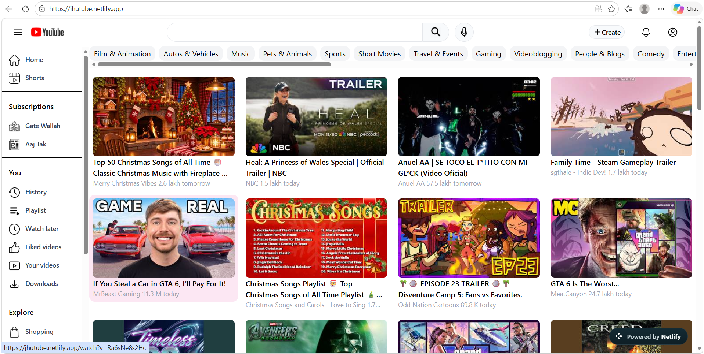
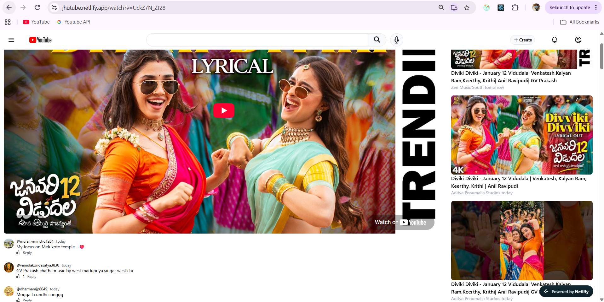
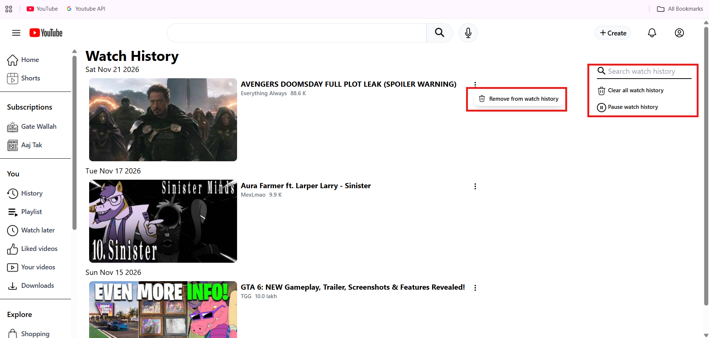
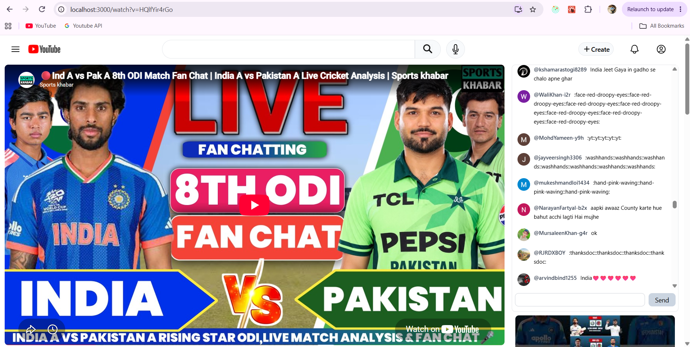
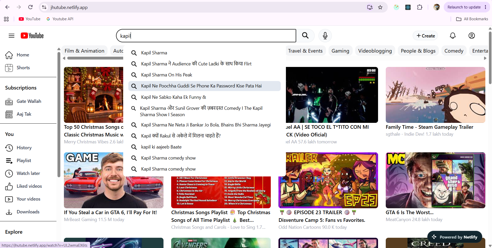
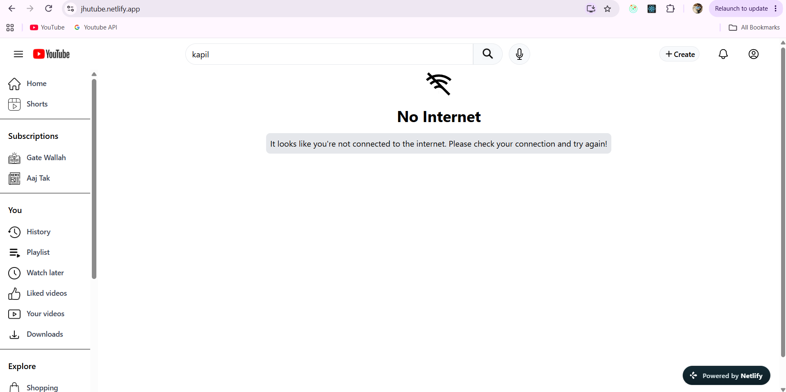

# Video Streaming Platform

**The goal wasn't simply to make it look like a video platform. It was to understand what it takes to make one work.**
    - This project is my attempt to go beyond recreating YouTube's look and feel and build the experience behind it — from discovering videos and navigating an endless feed to managing watch history, handling live chat, and keeping the interface responsive to real-world network conditions.
    - Along the way, I focused on solving the frontend challenges that make an application feel complete: efficient API interactions, state management, persistent data, infinite scrolling, and meaningful loading and offline experiences.


# Features

### Video Discovery
- Browse popular videos using the YouTube Data API.
- Filter the feed using video-category buttons.
- Load additional videos as the user scrolls using **Intersection Observer-based infinite scrolling**.

### Search
- Show video-title suggestions as the user types.
- **Debounce search input** to avoid making a request for every keystroke.
- **Cache** previously fetched suggestions in Redux to **reduce repeated API calls.**

### Watch Experience
- Open videos on a dedicated watch page.
- Display recommended videos alongside the selected video.
- Render comments with nested replies.
- Retrieve **live-chat messages** periodically through **API polling** when live chat is available.

### Watch History
- Store watched-video details in **Redux** and persist them in **localStorage.**
- Group watched videos by the date they were watched.
- Search within watch history.
- Remove individual videos from history.
- Clear the complete watch history.
- Pause and resume watch-history tracking.

### Network and Loading Experience
- Detect browser online/offline status.
- Display an offline fallback experience when the connection is unavailable.
- Use shimmer UI to provide feedback while asynchronous content is loading.

# Tech stack
    - React – component-based UI
    - Redux Toolkit – application-wide state management
    - React Redux – connecting React components to the Redux store
    - React Router – client-side routing
    - Tailwind CSS – styling
    - YouTube Data API v3 – video, search, category, comment and live-chat data
    - Browser APIs – IntersectionObserver, localStorage, and online/offline events

## Project Structure

The application is organized around these responsibilities:

VideoStreamingPlatform/
├── public/
├── screenshots/
│   ├── HomePage.png
│   ├── WatchPage.png
│   ├── HistoryPage.png
│   ├── LiveChat.png
│   ├── Search.png
│   └── FallbackUI.png
└── src/
    ├── components/    # Reusable UI components and page sections
    ├── utils/         # Redux slices, API constants, custom hooks and utilities
    ├── assets/        # Images and other static assets
    ├── mockData/      # Custom mock datasets for UI testing
    ├── App.js
    └── index.js
```


# Engineering highlights
    - Centralized state: Redux Toolkit manages shared application data such as search suggestions, video categories, and watch history.
    - Request efficiency: Debouncing and Redux caching help avoid unnecessary repeated search-suggestion requests.
    - Incremental loading: IntersectionObserver triggers additional feed requests as the user approaches the end of the list.
    - Persistent state: Watch-history data is restored from and synchronized with localStorage.
    - Asynchronous UI states: Shimmer placeholders and offline handling make loading and connectivity states visible to the user.
    - Polling: Live-chat messages are refreshed periodically when a supported live chat is available.

## Screenshots

### Home Page


### Watch Page


### Watch History


### Live Chat


### Search


### Offline Fallback UI
